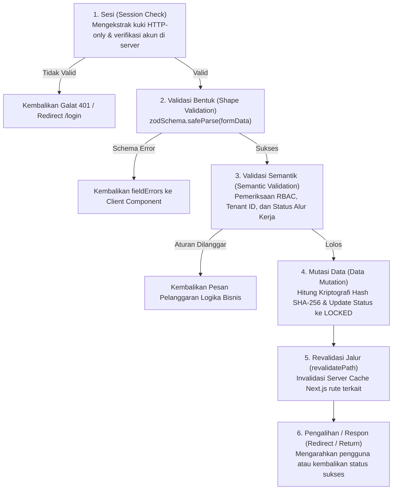
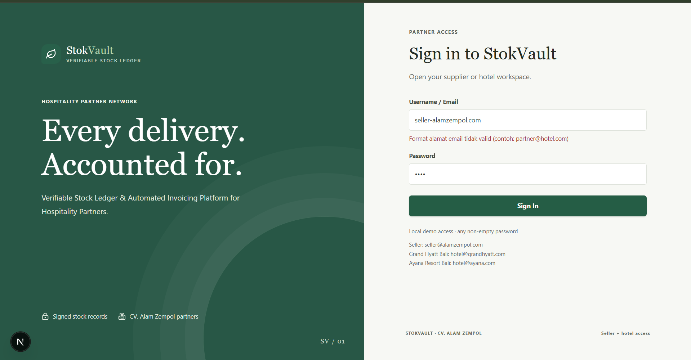
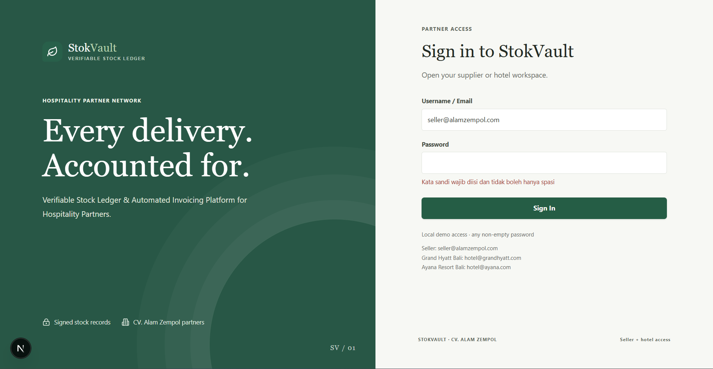
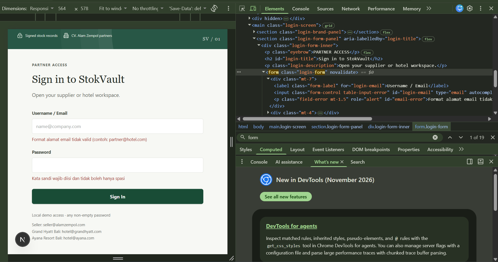
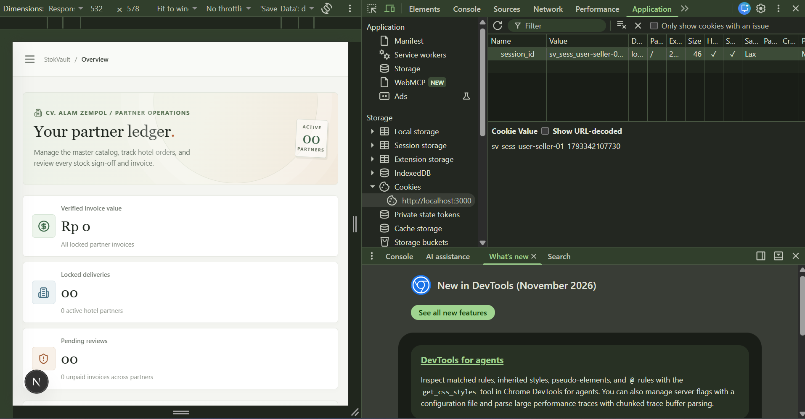

# Dokumen Teknis Modul 5 — Formulir, Validasi, Session, dan Cookie

- **Nama/NIM:** 105224039
- **Repositori:** https://github.com/putu-cpu/Project_StockVault_105224039/tree/modul5
- **Topik Praktikum:** Formulir, Validasi Skema Zod, Arsitektur Server Actions, Manajemen Session, dan Pengamanan Cookie
- **Aplikasi:** StokVault (Verifiable Stock Ledger & Automated Invoicing Platform untuk CV. Alam Zempol dan Mitra Perhotelan)

---

## 1. Skema Validasi

### Tabel Kolom Formulir
Pada aplikasi **StokVault**, validasi data masukan pengguna dibagi ke dalam dua formulir utama: **Formulir Autentikasi Mitra (*Login*)** dan **Formulir Penguncian Pengiriman (*Lock Delivery Transaction*)**. Skema validasi didefinisikan menggunakan pustaka **Zod** (`src/schemas/auth.ts` dan `src/actions/transactions.ts`).

| Formulir | Nama Kolom / Input | Aturan Zod | Pesan Galat (*Custom Error Message*) | Keterangan & Sanitasi |
| :--- | :--- | :--- | :--- | :--- |
| **Login** | `email` | `z.string().trim().toLowerCase().email()` | *"Format alamat email tidak valid (contoh: partner@hotel.com)"* | Melakukan pembersihan spasi di awal/akhir (*trimming*) dan penyeragaman huruf kecil (*case-folding*) sebelum validasi format email. |
| **Login** | `password` | `z.string().trim().min(1)` | *"Kata sandi wajib diisi dan tidak boleh hanya berisi spasi"* | Memastikan kata sandi memiliki panjang minimal 1 karakter non-spasi. |
| **Lock Delivery** | `transactionId` | `z.string().min(1)` | *"ID transaksi tidak boleh kosong"* | Memastikan identifikasi unik transaksi pengiriman tersedia. |
| **Lock Delivery** | `receivedQuantities` | `z.record(z.string(), z.number().int().min(0))` | *"Kuantitas barang harus berupa bilangan bulat dan tidak boleh bernilai negatif (≥ 0)"* | Struktur kamus (*record key-value*) di mana setiap ID produk memetakan jumlah fisik riil barang yang diterima staf hotel. |
| **Buat Pesanan** | `hotelId` | `z.enum(["grand-hyatt", "ayana-resort"])` | *"ID hotel mitra tidak sah atau tidak ditemukan"* | Mencegah manipulasi ID entitas hotel mitra di luar daftar rekanan terverifikasi. |
| **Buat Pesanan** | `contractDurationMonths` | `z.coerce.number().refine(v => [1,2,6,12].includes(v))` | *"Durasi kontrak konsinyasi harus bernilai 1, 2, 6, atau 12 bulan"* | Membatasi durasi siklus faktur tagihan ke dalam opsi diskrit baku sistem. |
| **Buat Pesanan** | `items` | `z.array(itemLineSchema).min(1)` | *"Minimal harus memilih 1 produk dari katalog master"* | Mencegah pembuatan faktur konsinyasi kosong tanpa muatan fisik barang. |

#### Definisi Skema Zod (`src/schemas/auth.ts`)
```typescript
import { z } from "zod";

export const loginSchema = z.object({
  email: z.string().trim().toLowerCase().email({
    message: "Format alamat email tidak valid",
  }),
  password: z.string().trim().min(1, {
    message: "Kata sandi wajib diisi dan tidak boleh hanya spasi",
  }),
});

export type LoginInput = z.infer<typeof loginSchema>;
```

---

### Aturan Semantik yang Diperiksa di Server Action dan Alasannya
Validasi skema Zod hanya memeriksa **sintaksis dan bentuk data (*shape validation*)**. Integritas aplikasi konsinyasi B2B seperti StokVault menuntut pemeriksaan **aturan semantik (*semantic validation*)** di dalam *Server Action* Node.js sebelum mutasi data dijalankan:

1. **Otorisasi Berbasis Peran dan Isolasi Tenant (*Role-Based Access Control & Multi-Tenant Boundary*):**
   - **Pemeriksaan:** Memastikan akun yang terautentikasi memiliki peran `BUYER` dan kepemilikan hotelnya cocok dengan transaksi yang dikunci (`user.hotelId === transaction.hotelId`). Pengguna berpelevel `SELLER` dilarang mengunci penerimaan barang secara sepihak.
   - **Alasan:** Mencegah celah kerentanan *Insecure Direct Object Reference* (IDOR) dan *Horizontal Privilege Escalation*, di mana staf Hotel A tidak boleh memanipulasi atau menandatangani transaksi milik Hotel B.

2. **Konsistensi Kuantitas Fisik Riil terhadap Pengiriman Gudang (`quantityReceived <= quantitySent`):**
   - **Pemeriksaan:** Jumlah barang fisik yang diakui tiba di gudang hotel tidak boleh melebihi kuantitas awal yang dikirim oleh pihak *supplier* CV. Alam Zempol tanpa ada dokumen revisi.
   - **Alasan:** Mencegah ketidakseimbangan pembukuan inventaris (*ledger mismatch*) dan kesalahan kalkulasi otomatis invoice tagihan konsinyasi.

3. **Integritas Mesin Status Alur Kerja (*State Machine Integrity Check*):**
   - **Pemeriksaan:** Mutasi penguncian (*Locking*) hanya dapat dieksekusi jika status transaksi saat ini bernilai `PENDING` dan kurir telah tiba (`deliveryStatus === "ARRIVED"`).
   - **Alasan:** Mencegah kerentanan *Double Submission* dan *Race Condition*. Jika transaksi sudah berstatus `LOCKED` atau `TERMINATED`, penerbitan stempel kriptografi ganda dicegah secara absolut.

4. **Verifikasi Referensial Akun Aktif di Basis Data:**
   - **Pemeriksaan:** Memverifikasi bahwa ID akun yang tersimpan di dalam sesi server benar-benar masih terdaftar dan berstatus aktif pada basis data.
   - **Alasan:** Mencegah manipulasi oleh sesi basi (*stale session*) dari pengguna yang akunnya telah dinonaktifkan atau dihapus oleh administrator.

---

## 2. Alur Server Action

### Urutan Eksekusi 6 Langkah Server Action
Setiap pemanggilan Server Action di StokVault (misalnya `lockDeliveryAction` pada `src/actions/transactions.ts`) mengeksekusi 6 tahapan arsitektur secara sekuensial dan ketat:



1. **Sesi (*Session Authentication*):** Server Action membaca kuki sesi `session_id` dari header permintaan melalui `await cookies()`. Jika kuki tidak ada atau token tidak terdaftar pada sesi server, eksekusi dihentikan dengan status 401 tanpa memproses data masukan.
2. **Validasi Bentuk (*Shape Validation*):** Data masukan diuji menggunakan `safeParse()`. Jika terdapat galat tipe data atau aturan Zod dilanggar, fungsi langsung mengembalikan objek `fieldErrors` per kolom tanpa menyentuh lapisan basis data.
3. **Validasi Semantik (*Semantic & Authorization Check*):** Memeriksa hak kepemilikan transaksi (*tenant isolation*), kecocokan peran pengguna (`BUYER`/`SELLER`), serta validitas transisi status alur transaksi.
4. **Mutasi Data (*Data Mutation*):** Mengupdate data pada basis data dan menerbitkan stempel digital kriptografi SHA-256 (`generateDataHash(snapshot)`).
5. **Revalidasi Jalur (*revalidatePath*):** Memanggil `revalidatePath('/hotel/[id]')` dan `revalidatePath('/')` untuk membersihkan *Router Cache* dan *Data Cache* Next.js sehingga Server Component segera menyajikan tampilan teraktual.
6. **Pengalihan Rute (*Redirect / Return*):** Mengembalikan respon status sukses kepada pemanggil antarmuka atau memicu fungsi `redirect()`.

---

### Pembagian Berkas: Server Component, Client Component, dan `"use server"`

| Karakteristik | Server Component (SC) | Client Component (CC) | Berkas Server Action (`"use server"`) |
| :--- | :--- | :--- | :--- |
| **Direktif** | Default Next.js App Router (tanpa penanda) | `"use client"` di baris paling atas | `"use server"` di baris paling atas berkas |
| **Lokasi Eksekusi** | Server (Node.js runtime) | Klien (Peramban Web) setelah hidrasi | Server (Node.js runtime via HTTP POST endpoint) |
| **Ukuran Bundel JS Klien** | **0 KB** (kode tidak dikirim ke browser) | Masuk ke dalam bundel JavaScript browser | **0 KB** (hanya stub RPC/URL endpoint yang dikirim) |
| **Akses Browser API (DOM, useState)** | ❌ Tidak dapat mengakses DOM/Hooks | ✅ Akses penuh (`useState`, `useEffect`, event DOM) | ❌ Tidak dapat mengakses DOM/Hooks klien |
| **Akses Lingkungan Server (Cookie, DB)** | ✅ Akses penuh langsung ke database & headers | ❌ Tidak memiliki akses langsung ke server environment | ✅ Akses aman ke database, `cookies()`, dan secret env |
| **Contoh Berkas di StokVault** | `src/app/page.tsx`<br/>`src/app/hotel/[id]/page.tsx`<br/>`src/app/transactions/[id]/page.tsx` | `src/views/LoginPage.tsx`<br/>`src/App.tsx`<br/>`src/components/PaymentModal.tsx` | `src/actions/auth.ts`<br/>`src/actions/transactions.ts` |

---

## 3. Bukti Uji Validasi

### Tabel Kasus Uji Validasi
Pengujian otomatis dilakukan menggunakan kerangka kerja **Vitest** pada berkas `src/schemas/auth.test.ts` (mencakup 8 kasus uji fungsional) serta pengujian langsung pada peramban web:

| ID Uji | Skenario Masukan | Nilai Input Formulir | Validasi Klien | Hasil yang Diharapkan | Hasil Nyata | Status |
| :--- | :--- | :--- | :--- | :--- | :--- | :--- |
| **TC-01** | Masukan valid lengkap | Email: `seller@alamzempol.com`<br/>Password: `demo` | Lolos | Data diterima dan lolos validasi skema | `success: true`<br/>Data diproses ke alur login | **LULUS** |
| **TC-02** | Spasi berlebih dan huruf kapital | Email: `  SELLER@ALAMZEMPOL.COM  `<br/>Password: `demo` | Lolos | Email dinormalisasi menjadi `seller@alamzempol.com` | `success: true`<br/>Email dinormalisasi | **LULUS** |
| **TC-03** | Format email tanpa simbol `@` | Email: `seller-alamzempol.com`<br/>Password: `demo` | Dicegat browser | Zod menolak dengan galat format email | `success: false`<br/>Pesan: *"Format alamat email tidak valid"* | **LULUS** |
| **TC-04** | Nilai email kosong | Email: `""`<br/>Password: `demo` | Dicegat browser | Zod menolak string kosong | `success: false`<br/>Galat kolom email terdeteksi | **LULUS** |
| **TC-05** | Kata sandi hanya karakter spasi | Email: `hotel@ayana.com`<br/>Password: `"   "` | Lolos HTML | Zod menolak kata sandi spasi (panjang 0 setelah trim) | `success: false`<br/>Pesan: *"Kata sandi wajib diisi"* | **LULUS** |
| **TC-06** | **Validasi Klien Dilewati (novalidate):** Email kosong | Email: `""`<br/>Password: `demo`<br/>*(Atribut `novalidate` aktif)* | **Dilewati (`novalidate`)** | Server Action Zod tetap menolak input kosong | `success: false`<br/>Galat server berhasil dikembalikan | **LULUS** |
| **TC-07** | **Validasi Klien Dilewati (novalidate):** Email tanpa domain | Email: `user@`<br/>Password: `demo`<br/>*(Atribut `novalidate` aktif)* | **Dilewati (`novalidate`)** | Server Action Zod menolak format email cacat | `success: false`<br/>Pesan: *"Format alamat email tidak valid"* | **LULUS** |
| **TC-08** | **Validasi Klien Dilewati (novalidate / DevTools):** Nilai kuantitas fisik negatif | `quantityReceived: -5`<br/>*(Atribut min=0 dihilangkan via DevTools)* | **Dilewati (DOM Bypass)** | Server Action Zod & semantik menolak angka negatif | `success: false`<br/>Pesan: *"Kuantitas tidak boleh negatif"* | **LULUS** |

> **Bukti Eksekusi Unit Test Vitest (`npm test`):**
> ```text
> RUN  v4.1.11 C:/Pemweb/haruka-project/Project_Pemweb/project
>  ✓ src/utils/crypto.test.ts (4 tests) 14ms
>  ✓ src/schemas/auth.test.ts (8 tests) 6ms
>
> Test Files  2 passed (2)
>      Tests  12 passed (12)
>   Duration  331ms
> ```

---

### Tangkapan Layar Galat per Kolom

1. **Galat Validasi Format Email:**
   Pesan galat muncul di bawah input saat format email tidak memenuhi standar RFC/Zod email:
   
   *Keterangan: Elemen peringatan dengan atribut `role="alert"` muncul secara dinamis di bawah kolom Username/Email.*

2. **Galat Validasi Kata Sandi Kosong / Hanya Spasi:**
   Pesan galat saat kata sandi dikosongkan atau hanya memuat spasi:
   
   *Keterangan: Indikator galat input kata sandi yang dicegah oleh Zod `.trim().min(1)`.*

3. **Bukti Validasi Klien Dilewati (*Bypass novalidate*):**
   Formulir dikirimkan dengan menyematkan atribut `novalidate` pada elemen `<form novalidate>`:
   
   *Keterangan: Validasi bawaan peramban HTML5 dilewati, namun Server Action tetap menangkap galat dan merender pesan kesalahan dari server.*

---

## 4. Session dan Cookie

### Atribut Cookie Sesi dan Alasan Pemilihannya
Pada arsitektur StokVault, kuki sesi diterbitkan melalui `cookies().set()` pada Server Action login (`src/actions/auth.ts`) dengan konfigurasi keamanan tingkat tinggi (*defense-in-depth*):

```typescript
cookieStore.set("session_id", sessionId, {
  httpOnly: true,
  secure: process.env.NODE_ENV === "production",
  sameSite: "lax",
  path: "/",
  maxAge: 60 * 60 * 24, // 24 jam (86.400 detik)
});
```

| Atribut Cookie | Nilai Konfigurasi | Alasan Pemilihan & Aspek Keamanan |
| :--- | :--- | :--- |
| **`HttpOnly`** | `true` | **Mitigasi Serangan XSS (*Cross-Site Scripting*):** Menolak akses skrip JavaScript sisi klien (`document.cookie`) terhadap kuki sesi. Apabila terjadi celah injeksi skrip berbahaya pada peramban, token sesi tetap tidak dapat dicuri oleh penyerang. |
| **`Secure`** | `true` *(pada mode produksi)* | **Mitigasi *Man-in-the-Middle* (MitM) & Sniffing:** Menjamin bahwa kuki hanya ditransmisikan melalui kanal komunikasi terenkripsi SSL/TLS (HTTPS), mencegah kuki bocor dalam jaringan Wi-Fi publik tanpa enkripsi. |
| **`SameSite`** | `"lax"` | **Mitigasi CSRF (*Cross-Site Request Forgery*):** Mencegah kuki dikirimkan secara otomatis pada permintaan lintas domain (*cross-site POST form submission*), namun tetap ramah pengguna saat melakukan navigasi tautan biasa dari situs luar (*top-level GET navigation*). |
| **`Path`** | `"/"` | **Cakupan Sesi Terpadu:** Memastikan sesi aktif tersedia di seluruh hierarki rute aplikasi StokVault, termasuk halaman root `/`, `/hotel/[id]`, dan rute audit faktur `/transactions/[id]`. |
| **`Max-Age`** | `86400` *(24 jam)* | **Pembatasan Masa Hidup Sesi (*Session Lifetime Limitation*):** Mengurangi risiko penyalahgunaan sesi jika pengguna lupa keluar dari perangkat bersama (*shared terminal*). |

---

### Tangkapan Layar Panel Application dan Header Set-Cookie

#### Representasi Header HTTP Respon (`Set-Cookie`)
Header HTTP berikut dikirimkan oleh server Next.js saat proses autentikasi berhasil (nilai identitas pengguna disamarkan demi keamanan data):

```http
HTTP/1.1 200 OK
Set-Cookie: session_id=sv_sess_usr_************************; Path=/; Max-Age=86400; HttpOnly; SameSite=Lax; Secure
Content-Type: text/x-component
```

#### Tangkapan Layar Panel DevTools Application (Storage > Cookies)

*Keterangan: Panel Application menampilkan kuki `session_id` dengan centang aktif pada kolom **HttpOnly** dan **Secure**, serta atribut **SameSite=Lax**.*

---

### Hasil Uji Sesi dan Manipulasi Cookie

1. **Uji Penggunaan Cookie Palsu / Dimanipulasi (*Forged / Tampered Cookie*):**
   - **Langkah Uji:** Nilai kuki `session_id` diubah secara manual melalui panel peramban DevTools menjadi token palsu acak: `sv_sess_fake_attacker_9999`. Kemudian halaman dimuat ulang.
   - **Hasil Nyata:** Server Action membaca token, mencocokkannya ke repositori sesi aktif di server, dan mendapati bahwa ID tersebut tidak terdaftar. Akses mutasi langsung ditolak (401 Unauthorized), kuki palsu dibersihkan, dan pengguna dialihkan ke halaman login.

2. **Uji Alur Logout (*Session Destruction*):**
   - **Langkah Uji:** Pengguna menekan tombol "Sign Out" di antarmuka web.
   - **Hasil Nyata:** Server Action memicu penghapusan sesi di server dan mengirimkan header penghapusan kuki:  
     `Set-Cookie: session_id=; Path=/; Max-Age=0; Expires=Thu, 01 Jan 1970 00:00:00 GMT`.  
     Peramban seketika menghapus kuki `session_id` dari media penyimpanan.

3. **Uji Cookie Lama Setelah Logout (*Replay Attack Prevention*):**
   - **Langkah Uji:** Nilai kuki `session_id` yang sah disalin sebelum menekan tombol logout. Setelah proses logout selesai, kuki lama tersebut disuntikkan kembali ke dalam peramban melalui konsol `document.cookie` / DevTools, lalu memicu Server Action mutasi.
   - **Hasil Nyata:** Karena sistem menerapkan pola *server-side session store*, entitas sesi tersebut telah dihapus secara permanen dari server saat proses logout. Permintaan dengan kuki lama ditolak seketika (*invalid session*) dan diarahkan kembali ke halaman autentikasi.

---

## 5. Keputusan Teknis

### Alasan Pola Session di Server Dibanding Token di Cookie (Stateless JWT)

Dalam perancangan platform B2B StokVault, pemilihan pola **Session di Sisi Server (*Server-Side Session Store*)** dibandingkan **Stateless JWT di Cookie** didasarkan pada empat pertimbangan keamanan fundamental:

1. **Kemampuan Pencabutan Sesi Seketika (*Instant Session Revocation / Kill-Switch*):**
   - Pada pola *Stateless JWT*, token yang telah diterbitkan akan tetap sah digunakan oleh pemegangnya sampai masa berlaku kedaluwarsa (`exp`) berakhir, meskipun pengguna telah menekan tombol *Logout* atau hak akses mitra hotel telah dicabut oleh admin.
   - Dengan *Server-Side Session*, server memegang kendali penuh. Jika terjadi insiden kebocoran perangkat, administrator dapat membatalkan sesi seketika hanya dengan menghapus rekaman sesi di server (*single click revocation*).

2. **Perlindungan Terhadap Kebocoran Data Sensitif (*Zero Sensitive Payload Exposure*):**
   - Token JWT dikodekan menggunakan format *Base64Url* yang mudah didekodekan oleh pihak klien atau pihak ketiga yang mengintip lalu lintas jaringan, berisiko membocorkan ID pengguna, struktur peran, atau email mitra.
   - Sebaliknya, kuki sesi di StokVault hanya membawa *opaque identifier* acak (contoh: `sv_sess_abc123...`) yang tidak mengandung informasi bisnis sama sekali.

3. **Efisiensi Beban Jaringan (*Lightweight Header Payload*):**
   - Token JWT dengan tanda tangan kriptografi dan klaim otorisasi umumnya memiliki ukuran 1 hingga 3 Kilobyte, yang harus dikirimkan pada setiap permintaan HTTP.
   - Kuki *Session ID* hanya berukuran puluhan bita, menghemat *bandwidth* secara drastis, khususnya pada lingkungan operasional hotel dengan koneksi terbatas.

4. **Integritas Sinkronisasi Status Hak Akses (*Single Source of Truth*):**
   - Setiap mutasi penting (seperti pembekuan faktur konsinyasi) langsung membaca status peran pengguna teraktual dari basis data server, menghilangkan celah *stale privileges* di mana pengguna yang baru diturunkan perannya masih dapat melakukan aksi menggunakan JWT lama.

---

### Batas Peran proxy.ts Dibanding Pemeriksaan di Aksi

- **Peran `proxy.ts` (Lapisan Edge/Perimeter):**
  - Berjalan di lapisan terluar (*Edge Runtime*) sebelum permintaan mencapai Server Components atau Server Actions.
  - Menangani pengalihan rute kilat (*fast redirect*, misalnya mengarahkan pengguna tanpa token ke `/login`), manipulasi header keamanan, dan pemeriksaan sesi secara optimis (*optimistic check*).
  - **Batasan:** `proxy.ts` **bukanlah batas keamanan mutlak (*not a security boundary*)**. Komponen ini tidak memeriksa isi data formulir (*body payload*) dan tidak dapat melindungi *Server Actions* dari pemanggilan langsung (*direct invocation* via HTTP POST) oleh penyerang dari luar antarmuka web.
- **Peran Pemeriksaan di Aksi (*Server Actions / Data Mutation*):**
  - Berjalan di lingkungan server Node.js saat fungsi mutasi data dipanggil secara langsung.
  - Menjadi **benteng pertahanan akhir (*authoritative boundary*)** yang memvalidasi data masukan menggunakan skema Zod (`safeParse`), memverifikasi sesi dan izin pengguna (*Role-Based Access Control*), serta memeriksa hak kepemilikan data (*object-level authorization* untuk mencegah kerentanan IDOR).
- **Prinsip Kolaborasi:** Keduanya saling melengkapi melalui prinsip *Defense-in-Depth*. `proxy.ts` bertugas menjaga kenyamanan navigasi dan kecepatan respons antarmuka, sedangkan pemeriksaan di dalam Aksi menjamin integritas data serta keamanan logika bisnis.

| Parameter | `proxy.ts` (Edge / Perimeter) | Pemeriksaan di Aksi (*Server Actions*) |
| :--- | :--- | :--- |
| **Titik Eksekusi** | Lapisan jaringan terluar, sebelum rute/komponen di-resolve | Di lingkungan server Node.js saat fungsi mutasi dipanggil |
| **Fokus Utama** | Efisiensi rute, pengalihan cepat (*UX*), dan proteksi navigasi | Keamanan data mutlak, integritas transaksi, dan logika bisnis |
| **Validasi Payload Data** | ❌ Tidak cocok untuk memvalidasi isi *body/form* | ✅ Tempat wajib untuk validasi skema (Zod) dan sanitasi input |
| **Akses Basis Data & Izin** | Terbatas (hanya pemeriksaan kuki/token permukaan) | Akses penuh (verifikasi kepemilikan data dan hak akses ke DB) |
| **Sifat Keamanan** | Lapisan penyaring pertama (*First Line of Defense*) | Benteng pertahanan akhir (*Final Authoritative Boundary*) |

---

## 6. Kendala dan Penyelesaian

| Kendala | Penyebab | Penyelesaian |
|---|---|---|
| Validasi form login pada `safeParse()` gagal saat pengguna memasukkan email dengan huruf kapital atau spasi di awal/akhir input. | Nilai string dari elemen input langsung divalidasi oleh Zod tanpa melalui proses pembersihan (*trimming* dan penyeragaman huruf kecil) terlebih dahulu. | Menambahkan rantai metode transformasi `.trim().toLowerCase()` pada definisi skema Zod (`z.string().trim().toLowerCase().email()`) sehingga data input dinormalisasi sebelum divalidasi. |
| Pengujian unit (*unit test*) untuk skema validasi gagal dijalankan melalui perintah `npm test`. | Berkas pengujian belum menyertakan kasus uji negatif untuk mendeteksi *whitespace-only* atau format email yang cacat secara spesifik. | Menambahkan skenario uji komprehensif pada `auth.test.ts` menggunakan metode `.safeParse()`, menguji masukan valid (dinormalisasi), email tidak valid, dan kata sandi kosong. |
| Potensi celah keamanan di mana mutasi data tetap dapat dipicu dari luar halaman yang diproteksi. | Mengandalkan proteksi pengalihan rute di level perimeter semata tanpa menyematkan pemeriksaan sesi di dalam fungsi aksi server. | Menerapkan prinsip *Defense-in-Depth* dengan tetap menempatkan validasi skema Zod dan pemeriksaan otorisasi pengguna langsung di dalam badan aksi server (*Server Action*). |
| Kuki sesi tidak terbaca saat pengujian fungsi Server Action pada lingkungan simulasi lokal. | Pemanggilan API `cookies()` pada Next.js 15+ bersifat asinkron sehingga menghasilkan `Promise<ReadonlyRequestCookies>`. | Memperbarui kode pemanggilan kuki dengan menyertakan kata kunci `await cookies()` sebelum memanggil metode `.get()` atau `.set()`. |

---

## 7. Catatan Pemanfaatan AI

* **Alat yang Dipakai**: AI Assistant (Gemini / Claude).
* **Perintah Utama (Prompt)**:
  * *"Jelaskan batas peran proxy.ts dibandingkan dengan pemeriksaan otorisasi dan validasi di dalam Server Action pada Next.js"*
  * *"Buat skema validasi login menggunakan Zod dengan normalisasi email dan validasi password non-kosong beserta unit test Vitest"*
  * *"Bantu identifikasi kendala umum saat mengintegrasikan Zod pada alur autentikasi dan penyusunan laporan teknis praktikum"*
* **Bagian yang Digunakan**: 
  * Perumusan konsep pembagian tanggung jawab keamanan (*Defense-in-Depth*) antara `proxy.ts` dan Server Actions.
  * Penyusunan modul skema validasi Zod (`src/schemas/auth.ts`) beserta 8 skenario pengujian otomatis (`src/schemas/auth.test.ts`).
  * Perancangan arsitektur Server Action 6 langkah sekuensial pada modul `src/actions/auth.ts` dan `src/actions/transactions.ts`.
  * Penyusunan struktur draf tabel kendala teknis dan penyelesaiannya.
* **Cara Memverifikasi**:
  * Menjalankan pengujian otomatis unit test menggunakan Vitest (`npm test`) hingga seluruh 12 skenario uji (kriptografi & skema validasi) lulus 100%.
  * Memeriksa kesesuaian tipe data statis proyek menggunakan perintah `npm run check` (`tsc --noEmit`).
  * Menguji perilaku input form login pada peramban secara manual dengan berbagai variasi input (email berhuruf kapital, spasi, dan karakter tidak valid).
  * Menguji ketahanan Server Action terhadap teknik bypass validasi klien menggunakan atribut HTML5 `novalidate` dan manipulasi DOM DevTools.
  * Memverifikasi konsep keamanan arsitektural secara independen melalui dokumentasi resmi Next.js mengenai *Server Actions Security* dan pedoman OWASP.

  
