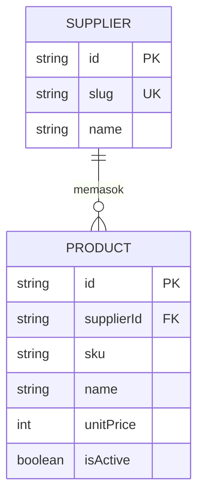
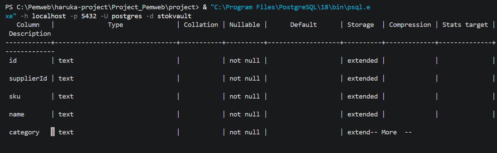
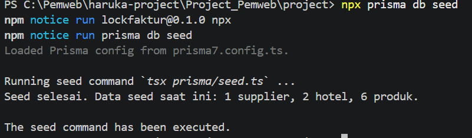
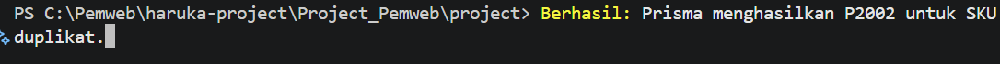
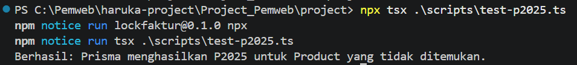
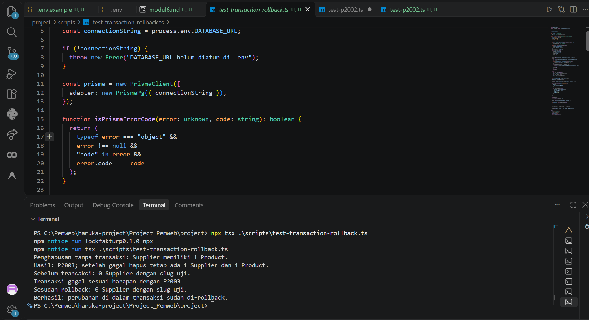

docs/praktikum/modul-06.md
# Dokumen Teknis Modul 6 — PostgreSQL dan Prisma ORM

- **Nama/NIM:** 105224039
- **Repositori:** [putu-cpu/Project_StockVault_105224039](https://github.com/putu-cpu/Project_StockVault_105224039)

## 1. Rancangan Data

### Diagram dua entitas, relasi, kunci, dan constraint unik

Contoh relasi yang dibahas adalah **Supplier** dan **Product**. Satu pemasok dapat memiliki banyak produk; setiap produk harus dimiliki tepat oleh satu pemasok.



- `Supplier.id` dan `Product.id` adalah primary key.
- `Product.supplierId` adalah foreign key ke `Supplier.id`.
- Pasangan `Product.supplierId` dan `Product.sku` memiliki constraint unik. SKU boleh sama untuk pemasok berbeda, tetapi tidak boleh duplikat di dalam pemasok yang sama.
- `Supplier.slug` juga unik pada skema.

### Alasan pemilihan `onDelete`

Relasi `Supplier`–`Product` menggunakan `onDelete: Restrict`. Pemasok tidak dapat dihapus selama masih memiliki produk yang merujuk kepadanya. Kebijakan ini mencegah data katalog atau riwayat transaksi kehilangan induk secara tidak sengaja. Untuk pemasok/produk yang tidak lagi aktif, pilihan yang lebih aman adalah menandainya tidak aktif (`isActive = false`), bukan menghapusnya.

Relasi `Product`–`TransactionItem` juga menggunakan `Restrict`, sehingga produk yang telah tercatat dalam transaksi tidak dapat dihapus dan merusak riwayat.

## 2. Skema dan Migrasi

### Isi prisma/schema.prisma

Berikut potongan model yang menunjukkan primary key, relasi, foreign key, constraint unik, dan indeks:

```prisma
generator client {
  provider = "prisma-client"
  output   = "../src/generated/prisma"
}

datasource db {
  provider = "postgresql"
}

model Supplier {
  id           String        @id @default(cuid())
  slug         String        @unique
  name         String
  legalName    String?
  email        String?
  phone        String?
  createdAt    DateTime      @default(now())
  updatedAt    DateTime      @updatedAt
  users        User[]
  products     Product[]
  transactions Transaction[]
}

model Hotel {
  id           String        @id @default(cuid())
  slug         String        @unique
  name         String
  location     String
  contactEmail String?
  phone        String?
  isActive     Boolean       @default(true)
  createdAt    DateTime      @default(now())
  updatedAt    DateTime      @updatedAt
  users        User[]
  transactions Transaction[]
}

model User {
  id                         String            @id @default(cuid())
  email                      String            @unique
  name                       String
  passwordHash               String
  role                       String
  supplierId                 String?
  hotelId                    String?
  isActive                   Boolean           @default(true)
  createdAt                  DateTime          @default(now())
  updatedAt                  DateTime          @updatedAt
  supplier                   Supplier?         @relation(fields: [supplierId], references: [id], onDelete: Restrict)
  hotel                      Hotel?            @relation(fields: [hotelId], references: [id], onDelete: Restrict)
  createdTransactions        Transaction[]     @relation("TransactionCreator")
  lockedTransactions         Transaction[]     @relation("TransactionLocker")
  approvedEditTransactions   Transaction[]     @relation("EditApprover")
  reviewedTerminationRecords Transaction[]     @relation("TerminationReviewer")
  stockCounts                TransactionItem[] @relation("StockCounter")
  processedPayments          Payment[]         @relation("PaymentProcessor")
  auditEvents                AuditEvent[]      @relation("AuditActor")

  @@index([supplierId, role])
  @@index([hotelId, role])
}

model Product {
  id               String            @id @default(cuid())
  supplierId       String
  sku              String
  name             String
  category         String
  size             String
  unitPrice        Int
  isActive         Boolean           @default(true)
  createdAt        DateTime          @default(now())
  updatedAt        DateTime          @updatedAt
  supplier         Supplier          @relation(fields: [supplierId], references: [id], onDelete: Restrict)
  transactionItems TransactionItem[]

  @@unique([supplierId, sku])
  @@index([supplierId, isActive])
}

model Transaction {
  id                      String            @id @default(cuid())
  reference               String            @unique
  supplierId              String
  hotelId                 String
  createdById             String
  lockedById              String?
  editAccessApprovedById  String?
  terminationReviewedById String?
  contractDurationMonths  Int
  status                  String            @default("PENDING")
  deliveryStatus          String            @default("PREPARING")
  editAccessRequestedAt   DateTime?
  editAccessApprovedAt    DateTime?
  terminationRequestedAt  DateTime?
  terminatedAt            DateTime?
  hashSignature           String?           @unique
  lockedAt                DateTime?
  createdAt               DateTime          @default(now())
  updatedAt               DateTime          @updatedAt
  deletedAt               DateTime?
  supplier                Supplier          @relation(fields: [supplierId], references: [id], onDelete: Restrict)
  hotel                   Hotel             @relation(fields: [hotelId], references: [id], onDelete: Restrict)
  createdBy               User              @relation("TransactionCreator", fields: [createdById], references: [id], onDelete: Restrict)
  lockedBy                User?             @relation("TransactionLocker", fields: [lockedById], references: [id], onDelete: Restrict)
  editAccessApprovedBy    User?             @relation("EditApprover", fields: [editAccessApprovedById], references: [id], onDelete: Restrict)
  terminationReviewedBy   User?             @relation("TerminationReviewer", fields: [terminationReviewedById], references: [id], onDelete: Restrict)
  items                   TransactionItem[]
  invoices                Invoice[]
  auditEvents             AuditEvent[]

  @@index([supplierId, createdAt])
  @@index([hotelId, createdAt])
  @@index([status, deliveryStatus])
}

model TransactionItem {
  id                      String        @id @default(cuid())
  transactionId           String
  productId               String
  skuSnapshot             String
  nameSnapshot            String
  categorySnapshot        String
  sizeSnapshot            String
  unitPriceSnapshot       Int
  quantitySent            Int
  quantityReceived        Int?
  remainingStock          Int?
  remainingStockCountedAt DateTime?
  countedById             String?
  createdAt               DateTime      @default(now())
  updatedAt               DateTime      @updatedAt
  transaction             Transaction   @relation(fields: [transactionId], references: [id], onDelete: Restrict)
  product                 Product       @relation(fields: [productId], references: [id], onDelete: Restrict)
  countedBy               User?         @relation("StockCounter", fields: [countedById], references: [id], onDelete: Restrict)
  invoiceLines            InvoiceLine[]

  @@unique([transactionId, productId])
  @@index([productId])
}

model Invoice {
  id            String        @id @default(cuid())
  transactionId String
  period        Int
  dueDate       DateTime
  status        String        @default("UNPAID")
  totalAmount   Int           @default(0)
  consumedUnits Int           @default(0)
  paidAt        DateTime?
  createdAt     DateTime      @default(now())
  updatedAt     DateTime      @updatedAt
  transaction   Transaction   @relation(fields: [transactionId], references: [id], onDelete: Restrict)
  lines         InvoiceLine[]
  payments      Payment[]

  @@unique([transactionId, period])
  @@index([status, dueDate])
}

model InvoiceLine {
  id                String          @id @default(cuid())
  invoiceId         String
  transactionItemId String
  quantityConsumed  Int
  unitPrice         Int
  lineTotal         Int
  createdAt         DateTime        @default(now())
  invoice           Invoice         @relation(fields: [invoiceId], references: [id], onDelete: Restrict)
  transactionItem   TransactionItem @relation(fields: [transactionItemId], references: [id], onDelete: Restrict)

  @@unique([invoiceId, transactionItemId])
  @@index([transactionItemId])
}

model Payment {
  id                String    @id @default(cuid())
  invoiceId         String
  processedById     String?
  method            String
  status            String    @default("PENDING")
  amount            Int
  receiptName       String?
  receiptStorageKey String?
  providerReference String?   @unique
  processedAt       DateTime?
  createdAt         DateTime  @default(now())
  invoice           Invoice   @relation(fields: [invoiceId], references: [id], onDelete: Restrict)
  processedBy       User?     @relation("PaymentProcessor", fields: [processedById], references: [id], onDelete: Restrict)

  @@index([invoiceId, createdAt])
  @@index([status, createdAt])
}

model AuditEvent {
  id            String       @id @default(cuid())
  transactionId String?
  actorId       String?
  action        String
  detailsJson   String?
  previousHash  String?
  eventHash     String       @unique
  createdAt     DateTime     @default(now())
  transaction   Transaction? @relation(fields: [transactionId], references: [id], onDelete: Restrict)
  actor         User?        @relation("AuditActor", fields: [actorId], references: [id], onDelete: Restrict)

  @@index([transactionId, createdAt])
  @@index([actorId, createdAt])
}

```

Skema lengkap juga memiliki entitas Hotel, User, Transaction, TransactionItem, Invoice, InvoiceLine, Payment, dan AuditEvent. Semua relasi dan aturan lengkapnya tercantum di [`schema.prisma`](../../../prisma/schema.prisma).

### Daftar folder prisma/migrations dan potongan migration.sql

Migrasi yang ditemukan:

```text
prisma/migrations/
├── migration_lock.toml
└── 20261106111600_init_postgresql/
    └── migration.sql

prisma/migrations-sqlite/
├── migration_lock.toml
└── 20261030093247_init/
    └── migration.sql
```

Migrasi PostgreSQL aktif dibuat dari skema Prisma. Migrasi SQLite lama tetap
diarsipkan di `prisma/migrations-sqlite/` dan tidak dijalankan oleh Prisma.
File `dev.db` tetap dipertahankan; pemeriksaan tabel menunjukkan semua tabel
aplikasi memiliki 0 baris, jadi tidak ada data aplikasi yang perlu disalin.

Potongan dari `prisma/migrations/20261106111600_init_postgresql/migration.sql`:

```sql
CREATE TABLE "Product" (
    "id" TEXT NOT NULL,
    "supplierId" TEXT NOT NULL,
    "sku" TEXT NOT NULL,
    "name" TEXT NOT NULL,
    "category" TEXT NOT NULL,
    "size" TEXT NOT NULL,
    "unitPrice" INTEGER NOT NULL,
    "isActive" BOOLEAN NOT NULL DEFAULT true,
    "createdAt" TIMESTAMP(3) NOT NULL DEFAULT CURRENT_TIMESTAMP,
    "updatedAt" TIMESTAMP(3) NOT NULL,
    CONSTRAINT "Product_pkey" PRIMARY KEY ("id")
);

CREATE INDEX "Product_supplierId_isActive_idx" ON "Product"("supplierId", "isActive");
CREATE UNIQUE INDEX "Product_supplierId_sku_key" ON "Product"("supplierId", "sku");

ALTER TABLE "Product" ADD CONSTRAINT "Product_supplierId_fkey"
  FOREIGN KEY ("supplierId") REFERENCES "Supplier"("id")
  ON DELETE RESTRICT ON UPDATE CASCADE;
```

### Tangkapan layar \d hasil psql (indeks dan foreign key)

Konfigurasi Prisma sekarang menggunakan PostgreSQL. PostgreSQL 18 sudah
terpasang dan berjalan secara lokal. Sebelum migrasi pertama, isi password
PostgreSQL pada `DATABASE_URL` di `.env` (gunakan `.env.example` sebagai
referensi; jangan commit password), lalu buat database dan terapkan migrasi
dari PowerShell:

```powershell
& "C:\Program Files\PostgreSQL\18\bin\createdb.exe" -h localhost -p 5432 -U postgres stokvault
cd C:\Pemweb\haruka-project\Project_Pemweb\project
npm run db:migrate
```

Jika database `stokvault` sudah dibuat, lewati perintah `createdb`. Prisma
Client dapat dibuat ulang dengan `npm run db:generate`.

Untuk melihat indeks dan foreign key tabel Product, buka `psql`:

```powershell
& "C:\Program Files\PostgreSQL\18\bin\psql.exe" -h localhost -p 5432 -U postgres -d stokvault
```

Kemudian jalankan di prompt `psql`:

```text
\d+ "Product"
```



Perintah tersebut menampilkan kolom, indeks, dan constraint foreign key
Product. **Tangkapan layar hasil aktual belum dilampirkan** karena koneksi
belum dapat diverifikasi tanpa password PostgreSQL lokal. Setelah migrasi
berhasil, ambil tangkapan layar hasil `\d+ "Product"` untuk bukti laporan.

## 3. Seed dan Prisma Client

### Implementasi dan hasil seed

Seed berada di `prisma/seed.ts` dan dikonfigurasi pada `prisma7.config.ts`
dengan perintah `tsx prisma/seed.ts`. Seed menggunakan operasi `upsert`
berdasarkan nilai unik (`Supplier.slug`, `Hotel.slug`, dan pasangan
`Product.supplierId + sku`), sehingga menjalankannya ulang tidak membuat
duplikat. Seed mengisi satu Supplier, dua Hotel, dan enam Product dari data
demo StokVault.

Jalankan dua kali dari folder `project` untuk memeriksa idempotensi:

```powershell
npx prisma db seed
```

| Eksekusi | Hasil aktual |
|---|---|
| Seed pertama | Berhasil. Data seed: 1 Supplier, 2 Hotel, 6 Product. |
| Seed kedua | Berhasil. Tetap 1 Supplier, 2 Hotel, 6 Product. |
| Pemeriksaan idempotensi | Lulus: jumlah record seed tidak bertambah saat seed dijalankan ulang. |

Keluaran terminal pada kedua eksekusi:

```text
Seed selesai. Data seed saat ini: 1 supplier, 2 hotel, 6 produk.
The seed command has been executed.
```



### Mengapa seed sebaiknya tidak mengimpor `lib/prisma.ts`?

`lib/prisma.ts` tidak ada pada proyek ini. Seed merupakan entry point CLI yang
berjalan terpisah dari Next.js, sehingga membuat Prisma Client sendiri dengan
adapter PostgreSQL (`PrismaPg`) dan mengimpor client hasil generate dari
`src/generated/prisma/client`. Cara ini menghindari ketergantungan pada modul
aplikasi Next.js serta memungkinkan seed menutup koneksi secara eksplisit
dengan `$disconnect()`.

## 4. Operasi CRUD

Seed sekarang menyimpan Supplier, Hotel, dan Product ke PostgreSQL dengan `upsert`. Pengujian P2002 juga dijalankan melalui `scripts/test-p2002.ts`. Namun, UI aplikasi masih memakai `src/data/mockData.ts` dan state React; operasi CRUD Prisma belum dihubungkan ke halaman atau Server Action. Tabel ini membedakan operasi yang sudah ada dari operasi CRUD yang masih perlu dibuat.

| Entitas | Implementasi saat ini | Metode CRUD untuk integrasi aplikasi | Galat relevan |
|---|---|---|---|
| Supplier | `prisma/seed.ts` memakai `supplier.upsert`; belum ada CRUD dari UI | `findMany`, `findUnique`, `create`, `update`, `delete` | `P2002` jika slug duplikat; `P2025` jika target update/delete tidak ditemukan; `P2003` jika masih direferensikan |
| Product | Seed memakai `product.upsert`; uji SKU duplikat menghasilkan `P2002`; katalog UI masih memakai data demo | `findMany`, `findUnique`, `create`, `update`, `delete` | `P2002` jika kombinasi supplier dan SKU duplikat; `P2025` jika target tidak ditemukan; `P2003` jika supplier tidak valid atau produk masih direferensikan |
| Transaction | Alur pengiriman masih memakai UI/demo dan Server Action tanpa Prisma | `findMany`, `findUnique`, `create`, `update`, `delete` | `P2002` jika reference duplikat; `P2003` jika relasi tidak valid atau record masih direferensikan; `P2025` jika target tidak ditemukan |
| TransactionItem | Rincian transaksi masih berasal dari data demo; belum ada operasi Prisma aplikasi | `findMany`, `findUnique`, `create`, `update`, `delete` | `P2002` jika pasangan transaksi-produk duplikat; `P2003` jika foreign key tidak valid atau masih direferensikan; `P2025` jika target tidak ditemukan |

**Bukti uji P2002:** skrip `scripts/test-p2002.ts` membuat dua Product dengan pasangan `supplierId` dan `sku` yang sama. Percobaan kedua ditangkap sebagai kode Prisma `P2002`; data uji dibersihkan setelahnya.



**Bukti uji P2025:** skrip `scripts/test-p2025.ts` mencoba memperbarui Product dengan ID acak yang tidak ada. Prisma menghasilkan kode `P2025`, dan tidak ada data yang diubah. Jalankan ulang dari folder proyek dengan:

```powershell
cd C:\Pemweb\haruka-project\Project_Pemweb\project
npx tsx .\scripts\test-p2025.ts
```

Keluaran aktual:

```text
Berhasil: Prisma menghasilkan P2025 untuk Product yang tidak ditemukan.
```

Untuk dokumentasi, ambil tangkapan layar terminal yang memperlihatkan perintah dan keluaran tersebut.

Uji ini memverifikasi kode galat pada Prisma Client, bukan pesan pada formulir. UI belum terhubung ke CRUD Prisma sehingga tampilan penanganan P2025 pada formulir belum diuji.




## 5. Transaksi dan Rollback

### Penghapusan tanpa transaksi

Skema membatasi penghapusan induk yang masih direferensikan (`onDelete: Restrict`). Contohnya, menghapus Supplier yang masih memiliki Product harus ditolak oleh basis data. Pada relasi yang dilanggar, Prisma dapat melaporkan galat foreign key, umumnya `P2003`.

Skenario diuji dengan skrip `scripts/test-transaction-rollback.ts`. Skrip
membuat Supplier sementara dengan satu Product, mencoba menghapus Supplier
tanpa transaksi, lalu memastikan penghapusan ditolak dan kedua record masih
ada. Setelah pemeriksaan, data sementara dibersihkan.

### Bukti rollback

Skrip yang sama menguji rollback menggunakan `$transaction`: Supplier
sementara dibuat di dalam transaksi, kemudian pembuatan Product dengan
`supplierId` yang tidak valid memicu `P2003`. Skrip membandingkan jumlah
Supplier dengan slug uji sebelum dan sesudah transaksi untuk memastikan data
yang dibuat di dalam transaksi ikut dibatalkan.

Jalankan dari terminal PowerShell pada folder `project`:

```powershell
cd C:\Pemweb\haruka-project\Project_Pemweb\project
npx tsx .\scripts\test-transaction-rollback.ts
```

Keluaran aktual:



## 6. Skenario Uji

Pengujian sistem dilakukan untuk memverifikasi fungsionalitas manajemen katalog konsinyasi (CRUD) dan integritas relasi data pada platform **StokVault** (CV. Alam Zempol) menggunakan PostgreSQL dan Prisma ORM.

### Ketentuan & Metrik Pengujian
- **Total Skenario:** 10 Skenario (8 Skenario CRUD + 2 Skenario Integritas Relasi Data).
- **Tingkat Kelulusan:** 10 dari 10 skenario berhasil (**100% Lulus**, memenuhi syarat minimal 90%).
- **Data Uji:** 100% menggunakan **data sintetis** produk konsinyasi hospitality (tanpa data pribadi nyata).

---

