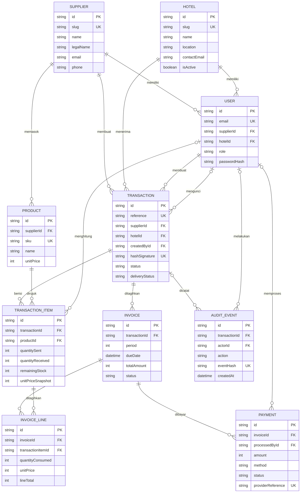

# Rancangan Basis Data StokVault

Basis data menggunakan PostgreSQL untuk pengembangan lokal. Skema menyimpan
organisasi pemasok, hotel mitra, akun, katalog, transaksi konsinyasi, detail
stok, invoice, pembayaran, dan jejak audit. Harga dan jumlah uang disimpan
sebagai bilangan bulat Rupiah untuk menghindari kesalahan pembulatan pecahan.

## Diagram relasi



`o|` pada diagram menandakan relasi opsional. Misalnya transaksi belum
memiliki pengguna pengunci sebelum hotel mengonfirmasi penerimaan.

## Entitas dan aturan data

- **Supplier, Hotel, User:** Memisahkan perusahaan pemasok, workspace hotel,
  dan akun pengguna. `User.role` bernilai `SELLER` atau `BUYER`; akun seller
  harus terkait ke pemasok, sedangkan akun buyer terkait ke hotel. Konsistensi
  peran dan tenant wajib divalidasi pada lapisan aplikasi.
- **Product:** Katalog milik pemasok. SKU unik di dalam satu pemasok. Harga
  disimpan dalam Rupiah sebagai integer.
- **Transaction:** Kontrak/pengiriman untuk satu pemasok dan satu hotel.
  `reference` adalah nomor transaksi yang terlihat pengguna. Status yang
  digunakan: `PENDING`, `LOCKED`, `TERMINATION_REQUESTED`, `TERMINATED`;
  status pengiriman: `PREPARING`, `IN_TRANSIT`, `ARRIVED`.
- **TransactionItem:** Rincian produk dalam pengiriman. Nama, SKU, kategori,
  ukuran, dan harga disalin sebagai snapshot agar perubahan katalog tidak
  mengubah catatan lama. `quantityReceived` dan `remainingStock` bernilai
  `NULL` sampai jumlah benar-benar dikonfirmasi; nol tetap berarti stok yang
  dihitung memang nol.
- **Invoice dan InvoiceLine:** Invoice dibuat per periode kontrak, dengan
  tepat satu invoice untuk setiap periode transaksi. Baris invoice menyimpan
  kuantitas konsumsi dan harga saat penagihan sebagai snapshot.
- **Payment:** Menyimpan riwayat upaya pembayaran per invoice, termasuk
  metode, status, nominal, referensi penyedia pembayaran, dan metadata nama/
  kunci bukti transfer. File bukti tidak disimpan langsung di database.
- **AuditEvent:** Mencatat aktor, tindakan, waktu, detail JSON, dan hash
  berantai opsional untuk membantu penelusuran perubahan. Hash SHA-256 saja
  tidak membuat catatan tahan manipulasi; penyimpanan append-only dan
  penandatanganan tepercaya tetap diperlukan untuk produksi.

Status dan role disimpan sebagai `String`.
Nilai yang diizinkan harus divalidasi secara eksplisit di server menggunakan
schema validasi aplikasi. Nilai status transaksi adalah `PENDING`, `LOCKED`,
`TERMINATION_REQUESTED`, atau `TERMINATED`; status pengiriman adalah
`PREPARING`, `IN_TRANSIT`, atau `ARRIVED`. Status invoice adalah `UNPAID` atau
`PAID`; metode pembayaran adalah `BCA_VA`, `MANDIRI_VA`, `QRIS`, atau
`BANK_TRANSFER`. Status pembayaran sebaiknya divalidasi sebagai `PENDING`,
`PAID`, `FAILED`, atau `REJECTED`; role adalah `SELLER` atau `BUYER`.
Setiap transaksi wajib memiliki minimal satu item meskipun constraint lintas
baris ini ditegakkan di server, bukan oleh constraint sederhana pada satu baris.

Harga, kuantitas, dan total harus integer non-negatif; kuantitas kirim harus
lebih dari nol. Aturan lintas kolom (misalnya stok tersisa tidak boleh
melampaui jumlah diterima) juga divalidasi dalam transaksi server.

## Kunci, constraint unik, dan indeks

| Model | Kolom | Aturan |
|---|---|---|
| `Supplier` | `id`, `slug` | Primary key CUID; slug unik |
| `Hotel` | `id`, `slug` | Primary key CUID; slug unik |
| `User` | `id`, `email` | Primary key CUID; email unik |
| `Product` | `id`, `supplierId + sku` | Primary key CUID; SKU unik per pemasok |
| `Transaction` | `id`, `reference`, `hashSignature` | Primary key CUID; reference unik; hash opsional dan unik |
| `TransactionItem` | `transactionId + productId` | Satu produk hanya sekali per transaksi |
| `Invoice` | `transactionId + period` | Satu invoice per periode transaksi |
| `InvoiceLine` | `invoiceId + transactionItemId` | Satu rincian item per invoice |
| `Payment` | `providerReference` | Opsional dan unik untuk idempotensi referensi pembayaran |
| `AuditEvent` | `eventHash` | Hash event unik |

Indeks tambahan mendukung pencarian transaksi per hotel/pemasok, invoice jatuh
tempo, status pembayaran, dan riwayat audit per transaksi atau aktor.

## Kebijakan `onDelete`

Semua relasi memakai `onDelete: Restrict`. Riwayat transaksi, snapshot
persediaan, invoice, pembayaran, dan audit tidak boleh hilang secara berantai
ketika akun, produk, hotel, atau pemasok dihapus. Data master yang tidak lagi
aktif sebaiknya dinonaktifkan (`isActive = false`), bukan dihapus. Transaksi
memiliki `deletedAt` untuk penghapusan logis; penghapusan permanen harus menjadi
proses retensi yang eksplisit setelah seluruh dependensi audit dan finansial
ditinjau.

## Menyiapkan basis data lokal

Jalankan dari folder `project`:

```powershell
# Buat database sekali, dan isi password PostgreSQL di DATABASE_URL pada .env
& "C:\Program Files\PostgreSQL\18\bin\createdb.exe" -h localhost -p 5432 -U postgres stokvault
npm run db:migrate
npm run db:generate
```

Gunakan `.env.example` sebagai format `DATABASE_URL`, lalu isi password lokal
di `.env` (jangan commit password). Untuk migrasi berikutnya gunakan
`npm run db:migrate -- --name nama_perubahan`; untuk deployment gunakan
`npm run db:deploy`. Migrasi membuat dan memperbarui skema PostgreSQL lokal
serta Prisma Client. Database awal sengaja kosong; buat akun pemasok, hotel,
produk, dan pengguna melalui
proses administrasi aplikasi setelah endpoint/server action terhubung. Jangan
menyimpan password teks biasa.

## Batas integrasi saat ini

Skema dan migrasi menyiapkan lapisan penyimpanan. Dashboard masih memakai
`src/data/mockData.ts` dan state React di memori; operasi aplikasi belum
dipindahkan ke database. Sebelum dipakai nyata, semua mutasi harus dijalankan
di server dalam transaksi database, dengan autentikasi, validasi tenant/role,
dan penyimpanan bukti transfer yang aman.
