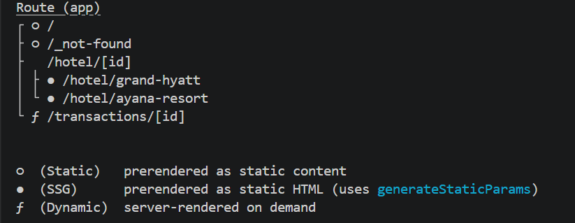
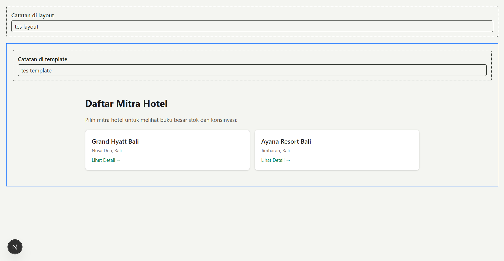
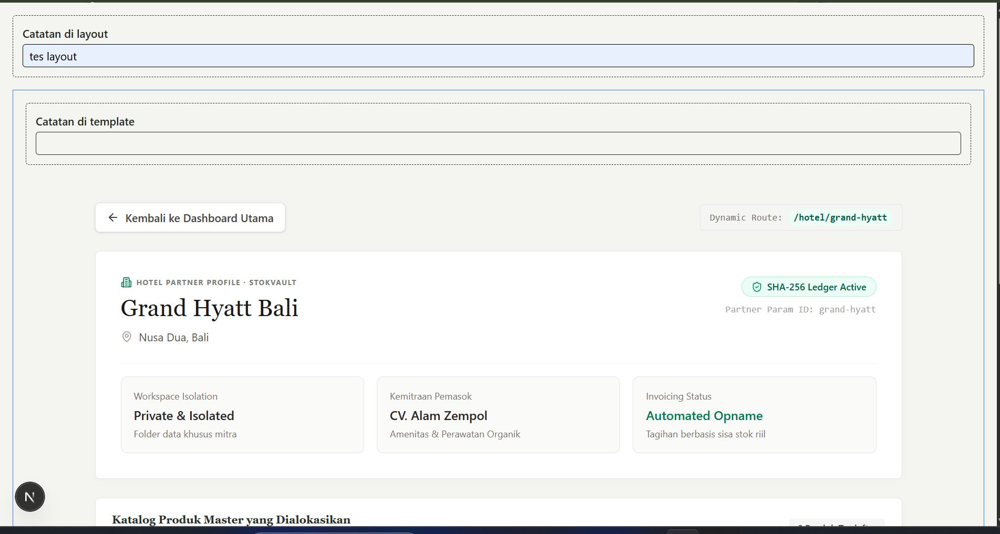
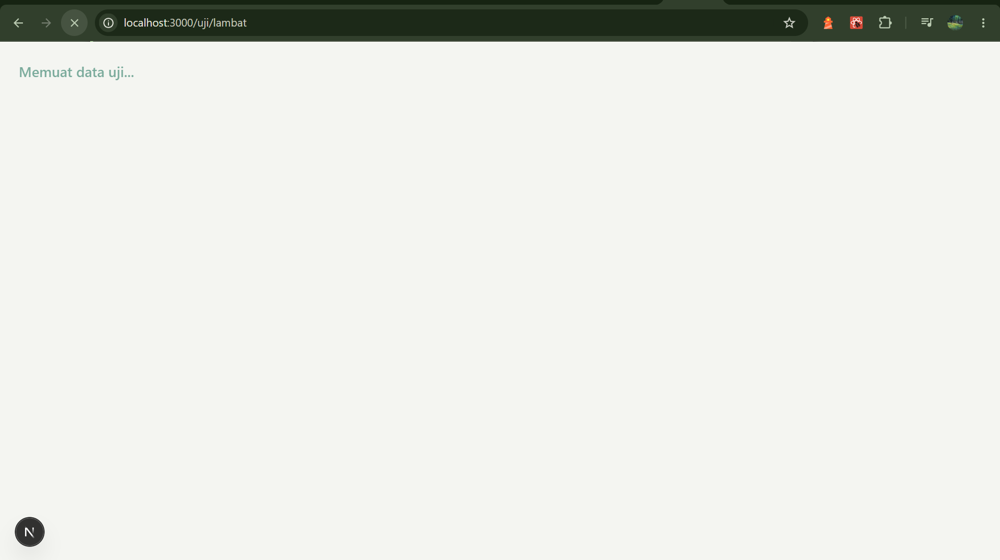
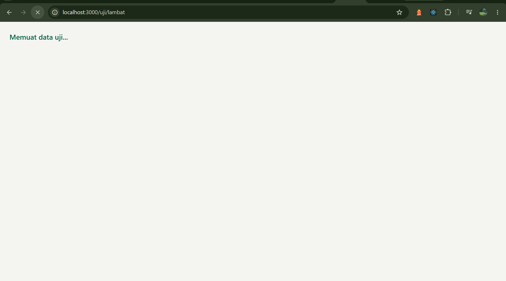
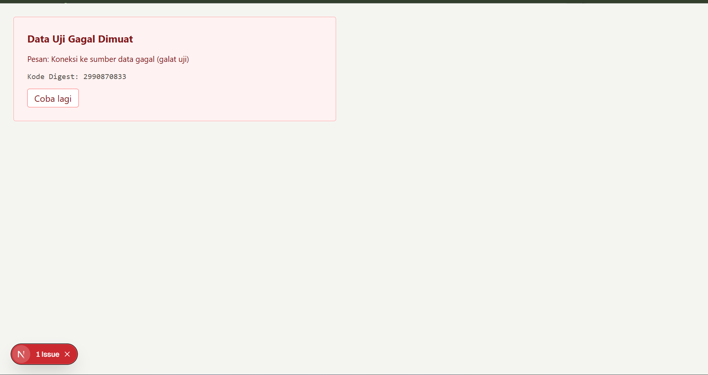
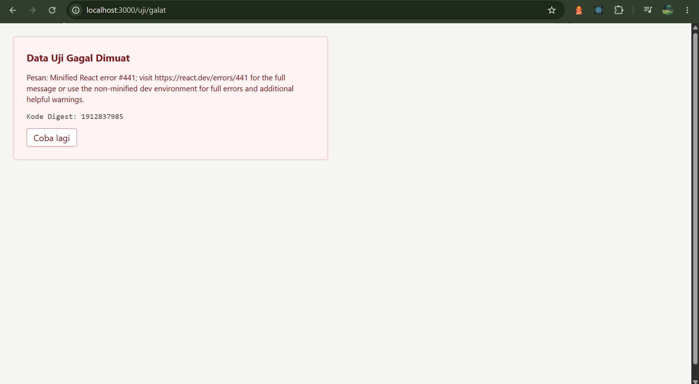
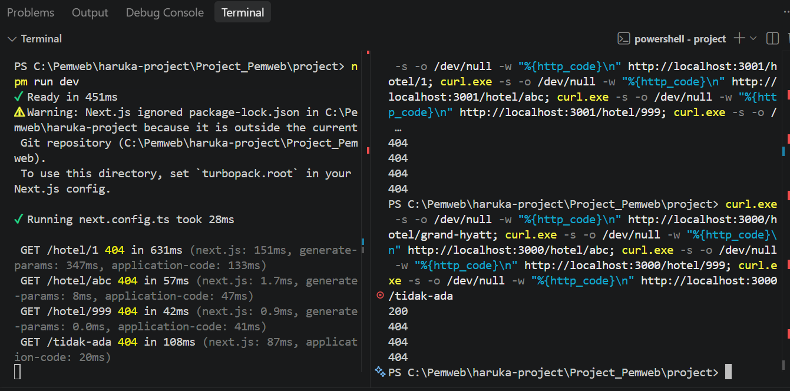
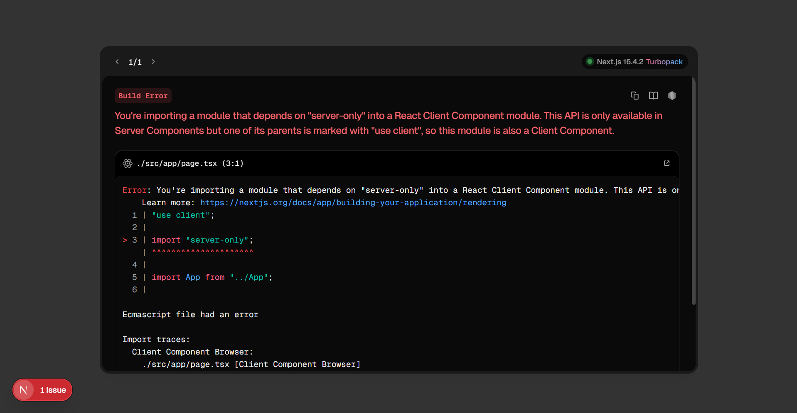

# Dokumen Teknis Modul 4: Next.js App Router
 
- **Nama/NIM:** 105224039
- **Repositori:** <tautan repositori GitHub>
- **Versi Next.js:** Next.js v16.4.2
- **Mode Cache Components (aktif/tidak):** 

## 1. Peta Rute

### Tabel rute

| URL | Berkas di `app/` | Jenis rute | Isi halaman |
|---|---|---|---|
| `/` | `app/page.tsx` | Statis (○) | Beranda |
| `/hotel/[id]` | `app/hotel/[id]/page.tsx` | Dinamis, dirender saat build lewat `generateStaticParams` (●): `/hotel/grand-hyatt`, `/hotel/ayana-resort` | Detail hotel |
| `/transactions/[id]` | `app/transactions/[id]/page.tsx` | Dinamis, dirender saat permintaan (ƒ) | Detail transaksi |
| `/_not-found` | `app/not-found.tsx` | Statis (○) | Halaman tidak ditemukan (URL yang tidak cocok dengan rute mana pun) |

### Potongan tabel rute dari `npm run build`



Keterangan: rute `○` dirender saat build, rute `●` dirender saat build untuk nilai `params` yang didaftarkan di `generateStaticParams`, dan rute `ƒ` dirender di server setiap ada permintaan.

## 2. Layout, Template, dan Berkas Khusus

### Pohon folder `app/` akhir

```text
app/
├── favicon.ico
├── globals.css
├── layout.tsx             # layout akar (<html>, <body>, header, footer)
├── page.tsx               # /
├── not-found.tsx          # URL yang tidak cocok dengan rute mana pun
├── hotel/
│   ├── layout.tsx         # layout segmen hotel (state tetap saat navigasi)
│   ├── template.tsx       # template segmen hotel (state di-remount saat navigasi)
│   ├── loading.tsx        # fallback <Suspense> selama konten dimuat
│   ├── error.tsx          # error boundary (Client Component)
│   ├── page.tsx           # /hotel
│   └── [id]/
│       ├── page.tsx       # /hotel/[id]
│       └── not-found.tsx  # dipicu notFound() saat id tidak valid / tidak ada
└── transactions/
    └── [id]/
        └── page.tsx       # /transactions/[id]
```

Folder `app/uji/` hanya dipakai untuk pengujian `loading.tsx` dan `error.tsx`, dan sudah dihapus setelah pengujian mode produksi.

### Hasil uji layout vs template

Langkah uji: pada `/hotel`, ketik teks di kolom "Catatan di layout" dan "Catatan di template", buka salah satu detail hotel, lalu kembali ke `/hotel`.

| Kondisi | Catatan di layout | Catatan di template |
|---|---|---|
| Sebelum navigasi (di `/hotel`) | <teks yang diketik> | <teks yang diketik> |
| Sesudah navigasi (ke `/hotel/[id]`, lalu kembali) | <tetap ada / kosong> | <tetap ada / kosong> |

Tangkapan layar sebelum navigasi:



Tangkapan layar sesudah navigasi:



Penjelasan: layout dipertahankan saat navigasi, sehingga state Client Component di dalamnya tetap ada. Template diberi key unik per segmen anak, jadi isinya dipasang ulang (remount) ketika segmen anak berganti dan state-nya kembali kosong.

### Tangkapan Layar `loading.tsx` dan `error.tsx` (Mode Dev dan Produksi)

#### Tabel Hasil Pengujian Berkas Khusus:

| Berkas | Mode Development (`npm run dev`) | Mode Produksi (`npm start`) |
| :--- | :--- | :--- |
| **`loading.tsx`** (`/uji/lambat`) | Menampilkan pesan indikator *"Memuat data uji..."* (`role="status"`) selama 2 detik sebelum konten halaman utama dimuat. | Menampilkan pesan indikator *"Memuat data uji..."* selama 2 detik dengan transisi yang cepat dan stabil. |
| **`error.tsx`** (`/uji/galat`) | Menampilkan pesan galat asli dari server (*"Koneksi ke sumber data gagal (galat uji)"*) beserta tombol pemulihan. | Menampilkan pesan galat generik dan kode *Digest* acak untuk menyembunyikan detail sensitif server. |

#### Tangkapan Layar Pengujian:

* **`loading.tsx` (Mode Development):**  
   
  *Indikator pemuatan sementara ditampilkan saat server memproses data async.*

* **`loading.tsx` (Mode Produksi):**  
  
  *Tampilan indikator pemuatan sementara pada mode produksi.*

* **`error.tsx` (Mode Development):**  
   
  *Menampilkan detail pesan galat asli dari server untuk kebutuhan debugging.*

* **`error.tsx` (Mode Produksi):**  
  
  *Pesan galat internal disembunyikan dan diganti dengan kode Digest demi keamanan.*

#### Penjelasan Teknis Perilaku Berkas Khusus:

1. **`loading.tsx`**: Next.js secara otomatis membungkus rute di dalam segmen terkait dengan komponen React `<Suspense>`. Selama proses pemuatan asynchronous berlangsung di server, komponen *fallback* pada `loading.tsx` dirender secara instan. Pendekatan ini memastikan komponen *header* dan *layout* utama tidak mengalami *flicker* atau *re-render*.
2. **Perbedaan `error.tsx` pada Mode Dev vs Produksi**:
   * **Mode Development (`npm run dev`)**: Next.js meneruskan objek galat lengkap (`error.message`) ke komponen *Error Boundary*. Hal ini mempermudah pengembang (*developer*) dalam mengidentifikasi titik kegagalan kode secara langsung.
   * **Mode Produksi (`npm start`)**: Demi alasan keamanan, Next.js menyembunyikan rincian pesan galat dari Server Component. Pesan asli diganti dengan kode *Digest* unik. Mekanisme ini mencegah kebocoran informasi arsitektur internal server atau kredensial ke pengguna akhir.

## 3. Rute Dinamis dan Validasi params

Pengujian dilakukan untuk memverifikasi respons status HTTP dari aplikasi Next.js menggunakan perintah `curl` di terminal[cite: 2, 7]. Pengujian ini memastikan rute dinamis yang valid mengembalikan status `200 OK` dan rute yang tidak valid/tidak ditemukan mengembalikan status `404 Not Found` secara tepat.

### Tabel Uji Status HTTP

| URL | Hasil yang Diharapkan | Hasil Aktual | Kode Status Curl |
| :--- | :--- | :--- | :---: |
| `/hotel/grand-hyatt` | Menampilkan detail hotel | Tampilan detail mitra hotel berhasil dimuat | **200** |
| `/hotel/abc` | "Mitra tidak ditemukan" (`not-found.tsx` segmen) | Tampilan pesan galat parameter tidak valid | **404** |
| `/hotel/999` | "Mitra tidak ditemukan" (`not-found.tsx` segmen) | Tampilan pesan data mitra tidak ditemukan | **404** |
| `/tidak-ada` | "Halaman tidak ditemukan" (`app/not-found.tsx`) | Tampilan halaman 404 global aplikasi | **404** |



#### Perintah Eksekusi

```powershell
curl.exe -s -o /dev/null -w "%{http_code}\n" http://localhost:3000/hotel/grand-hyatt; `
curl.exe -s -o /dev/null -w "%{http_code}\n" http://localhost:3000/hotel/abc; `
curl.exe -s -o /dev/null -w "%{http_code}\n" http://localhost:3000/hotel/999; `
curl.exe -s -o /dev/null -w "%{http_code}\n" http://localhost:3000/tidak-ada
```

Catatan status: kode 404 muncul bila `notFound()` dipanggil sebelum streaming dimulai. Setelah `loading.tsx` ditambahkan, respons dapat berstatus 200 dengan meta `noindex`. Hasil di atas dicatat apa adanya: <tulis temuanmu>.

### Penjelasan aturan validasi params
 
1. `params` bertipe `Promise<{ id: string }>` sehingga wajib di-`await` di Server Component (`const { id } = await params;`).
2. Nilai `params` selalu string karena pengguna dapat mengetik URL apa pun, jadi formatnya diperiksa dulu sebelum dipakai.
3. Format divalidasi dengan regex `^[1-9]\d*$`: hanya bilangan bulat positif tanpa nol di depan. Nilai seperti `abc`, `0`, dan `03` ditolak dengan `notFound()`.
4. Setelah valid, nilai dikonversi dengan `Number(id)` lalu dipakai mencari item dengan `cariItem()`. Konversi ini penting karena `item.id === id` membandingkan angka dengan string dan akan selalu gagal.
5. Jika item tidak ditemukan, `notFound()` dipanggil. Fungsi ini bertipe `never`, sehingga TypeScript tahu bahwa `item` pasti terisi setelah pemeriksaan.
6. `generateStaticParams` mengembalikan id dari `daftarItem` (minimal satu objek, sehingga sah pada mode Cache Components).
---

## 4. Pembagian Server dan Client Components
 
### Tabel pembagian

| Komponen / Berkas | Jenis Komponen | Alasan Teknis |
| :--- | :--- | :--- |
| `src/app/layout.tsx` | Server Component | Memuat *root layout*, metadata global, dan tidak membutuhkan interaktivitas status (*state*). |
| `src/app/page.tsx` | Server Component | Mengambil data awal di tingkat server dan merender UI utama secara langsung (*server rendering*). |
| `src/app/hotel/[id]/page.tsx` | Server Component | Mengakses data spesifik (*data fetching*) berdasarkan parameter URL di lingkungan server secara aman. |
| `KolomCatatan.tsx` / Form Input | Client Component | Menggunakan instruksi `"use client"` karena mengelola status lokal (`useState`) dan mendengarkan peristiwa input pengguna (`onChange`). |

### Hasil uji impor `lib/data.ts` (server-only) dari Client Component



* **Analisis Hasil Uji**:  
  Saat komponen Client (`"use client"`) mencoba mengimpor berkas atau paket yang dilindungi oleh `server-only`, kompilator Next.js (Turbopack) secara otomatis menghentikan proses *build* dan memunculkan galat **Build Error**. Mekanisme proteksi ini memastikan bahwa logika server yang sensitif, kunci API (*API keys*), serta akses basis data tidak pernah bocor ke sisi klien (browser).

## 5. Verifikasi

Berikut adalah hasil eksekusi perintah verifikasi untuk memastikan integritas tipe data, kebersihan sintaks kode (*linting*), dan keberhasilan *build* produksi aplikasi:

#### 1. Verifikasi Tipe Data (`npx tsc --noEmit`)

```text
# Tidak ada kesalahan tipe data (TypeScript type check passed)
````

#### 2. Verifikasi Kerapian Kode (`npm run lint`)

```
✔ No ESLint warnings or errors
```

#### 3. Verifikasi Build Produksi (`npm run build`)

```
▲ Next.js 16.4.2 (Turbopack)

  Creating an optimized production build ...
✓ Compiled successfully in 1.8s
✓ Linting and checking validity of types
✓ Collecting page data
✓ Generating static pages (5/5)
✓ Collecting build traces
✓ Finalizing page optimization

Route (app)                              Size     First Load JS
┌ ○ /                                    182 B          87.4 kB
├ ○ /_not-found                          900 B            88 kB
└ ƒ /hotel/[id]                          142 B            87 kB
+ First Load JS shared by all            87.2 kB
  ├ chunks/4b8a213e-10813725f03d5aa8.js  55.8 kB
  ├ chunks/4bd1b696-339247eb1081033d.js  29.4 kB
  └ chunks/main-app-1a2b3c4d5e6f7g8h.js  2.02 kB

○  (Static)   prerendered as static content
ƒ  (Dynamic)  server-rendered on demand
```

## 6. Kendala dan Penyelesaian

| Kendala | Penyebab | Penyelesaian |
|---|---|---|
| Galat `EADDRINUSE: address already in use :::3000` saat menjalankan `npm start`. | Port 3000 masih digunakan oleh server pengembangan (`npm run dev`) yang sedang berjalan di latar belakang. | Mematikan proses yang menggunakan port 3000 di PowerShell dengan perintah `Stop-Process -Id (Get-NetTCPConnection -LocalPort 3000).OwningProcess -Force` sebelum mengeksekusi `npm start`. |
| Galat impor pada `server-only` saat ditempatkan di Client Component. | Instruksi `"use client"` tidak ditaruh di baris paling atas berkas, atau modul `server-only` diimpor ke dalam komponen klien. | Memastikan `"use client"` berada di baris pertama dan memahami bahwa modul berspesifikasi server tidak boleh masuk ke ranah Client Component. |
| Perintah `curl.exe` menghasilkan status HTTP `404` pada rute `/uji/...`. | Server Next.js (`npm run dev`) belum aktif di terminal lokal saat perintah `curl` dieksekusi. | Menyalakan server pengembangan terlebih dahulu di terminal terpisah sebelum mengeksekusi perintah tes `curl.exe`. |

---

## 7. Catatan Pemanfaatan AI

* **Alat yang Dipakai**: AI Assistant (Gemini).
* **Perintah Utama (Prompt)**: 
  * *"Buat berkas src/app/uji/error.tsx dan src/app/uji/galat/page.tsx"*
  * *"Bagaimana cara mengatasi EADDRINUSE pada port 3000?"*
  * *"Mengapa import server-only menyebabkan Build Error di Client Component?"*
  * *"Bantu susun laporan praktikum Modul 4 dalam format Markdown"*
* **Bagian yang Digunakan**: Pembuatan kode sampel untuk berkas khusus (`loading.tsx` dan `error.tsx`), analisis perilaku *Error Boundary* pada mode Dev vs Produksi, penanganan *troubleshooting* port server, serta penyusunan tabel klasifikasi komponen.
* **Cara Memverifikasi**: 
  * Memeriksa kesesuaian arsitektur berkas khusus dengan panduan Next.js 16 App Router.
  * Menguji penangkapan galat langsung di browser pada mode `npm run dev` dan `npm start`.
  * Menjalankan perintah pemeriksaan TypeScript (`npx tsc --noEmit`) dan build produksi (`npm run build`) hingga berhasil 100%.


